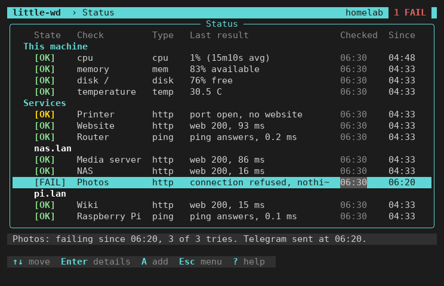

# little-watchdog

A small watchdog for your homelab. It checks your machines and services once a
minute and tells you on Telegram when one stops answering, and again when it is
back.



- **Set up in the terminal.** `little-wd` is a full-screen program: type an
  address, done. No web interface, no open port.
- **Watches** pings, web pages, ports, and its own machine (disk, memory,
  temperature, CPU).
- **Tells you** on Telegram. A dead-man's switch (Healthchecks.io) tells you
  when the watchdog itself stops.
- **Small.** One static binary, about 10 MB of RAM (measured with a handful of
  checks, 15 MB with 40). Linux with systemd.

For homelabs, not for critical infrastructure. Unofficial; not affiliated with
Telegram or Healthchecks.io.

## Quick start

On Debian, Ubuntu or Raspberry Pi OS:

```sh
wget -q --show-progress https://github.com/DockSeed/little-watchdog/releases/download/v0.6.1/little-watchdog_0.6.1_$(dpkg --print-architecture).deb
sudo apt install ./little-watchdog_0.6.1_*.deb
```

1. Answer `y` when the installer asks to add you to the group `little-wd`.
2. Log out and in again. Close an SSH session completely; a new shell is not
   enough.
3. Run `little-wd`. It greets you, asks for a first address, then sets up
   Telegram.

Full guide, with verifying the download: [docs/setup.md](docs/setup.md).

## Documentation

| | |
|---|---|
| [Setup guide](docs/setup.md) | Install, first check, Telegram, dead-man's switch, several machines, update. |
| [Using little-wd](docs/screens.md) | The screens, keys and screen sizes. |
| [Configuration](docs/config.md) | Every config key, check options, limits, disk writes, the service. |
| [Security](SECURITY.md) | What is protected, what is not, how to report a problem. |
| [How we built it](docs/how-we-built-it.md) | Goals, choices, how it was tested. |

## Commands

| Command | Does |
|---|---|
| `little-wd` | Full-screen setup and status (needs a terminal). |
| `little-wd status` | Prints the last results as a table. |
| `little-wd check` | Runs all checks once, prints the results, sends nothing. |
| `little-wd run` | Runs the watchdog; the systemd service does this. |
| `little-wd version` | Prints the version. |

All take `-config PATH`. Default: `$LITTLE_WATCHDOG_CONFIG`, else
`/etc/little-watchdog/little-watchdog.env`. `little-wd COMMAND -h` shows the
help for one command; `man little-wd` lists files, environment and exit codes.

## Build from source

Not needed for the packages above.

```sh
go test -race ./...
scripts/build.sh 0.6.1      # all packages in ./dist, same bytes every time
```

## Who wrote this

One human and AI coding agents (Claude). The agents wrote the code, the tests
and the documentation; the human made the decisions. More:
[how we built it](docs/how-we-built-it.md).

MIT licence, see [LICENSE](LICENSE).
