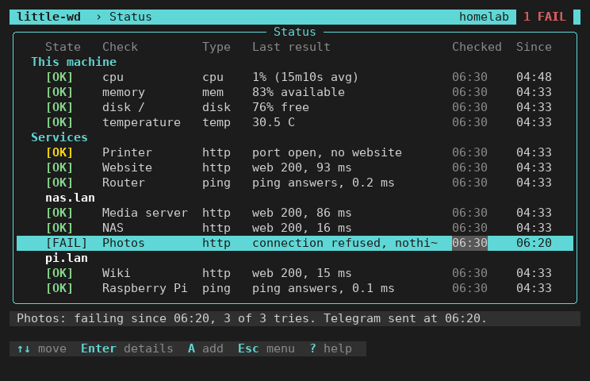
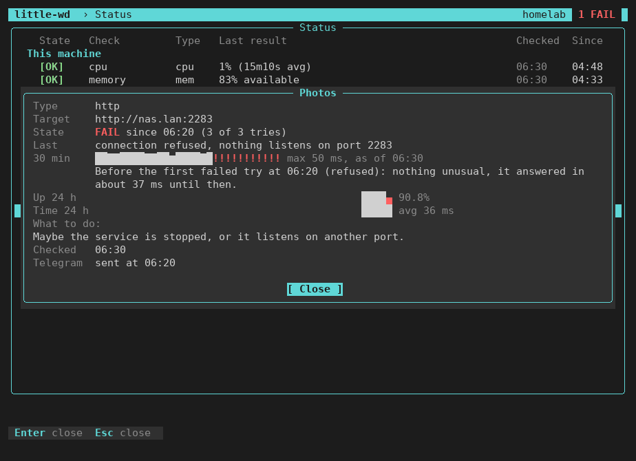
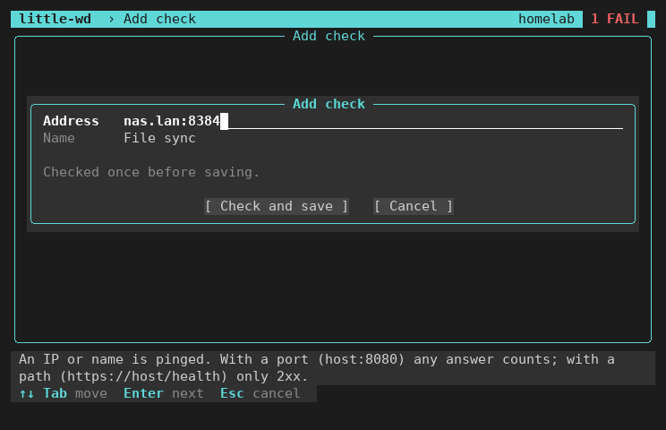
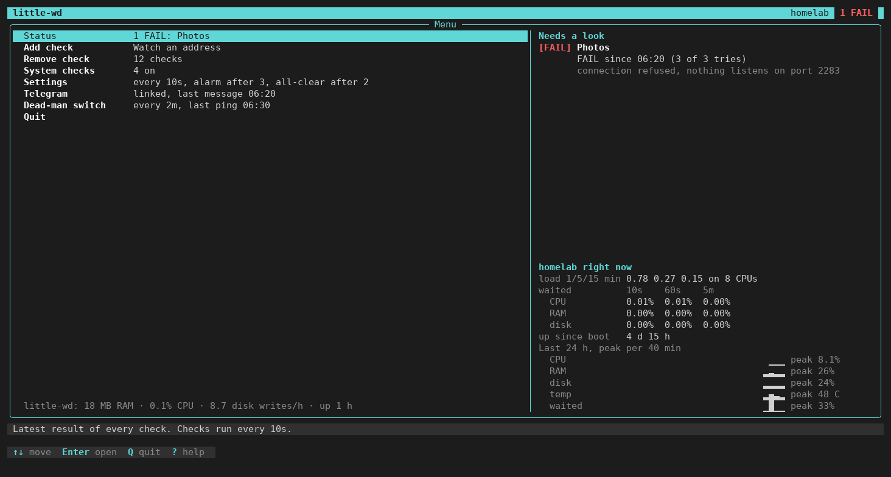

# Using little-wd

`little-wd` without a command opens the full-screen program. It shows what the
watchdog sees and changes its config. The watchdog itself runs as a service in
the background; quitting `little-wd` does not stop it.

The pictures show a demo homelab, taken from little-wd 0.6.0.

## Menu

| Entry | Does | Shows next to it |
|---|---|---|
| Status | the list of all checks | all OK, or which checks fail |
| Add check | watch a new address | |
| Remove check | stop watching a check, also a system check | number of checks |
| System checks | limits for this machine: CPU, memory, disk, temperature | how many are on |
| Settings | check interval, alarm and all-clear rounds, timeout, state in RAM | the current values |
| Telegram | pair a bot | linked, last message |
| Dead-man switch | Healthchecks ping URL and interval | last ping |
| Quit | leave `little-wd` | |

The bottom line of the menu shows what little-wd itself costs: RAM, CPU and
disk writes.

## Status

One line per check: **This machine** first, then **Services**. Checks of one
host stand together under its name (the IP or host name from the address,
without port or path). A host with a single check gets no extra line.

| Column | Means |
|---|---|
| State | `[OK]`, `[FAIL]`; `[2/3]` = 2 of 3 tries failed, no alarm yet; `[?]` = no result yet |
| Last result | what was checked, then the time: `web 200, 41 ms`, `port open, 1 ms`, `ping answers, 3 ms` |
| Checked | time of the last result |
| Since | when this state began (an OK at most since the daemon start) |

A yellow `[OK]` answers, but not as the address promised: `port open, no
website`. It sends no alarm. After a FAIL, `back 1/2` counts the good tries
until the all-clear.

- Enter opens the details of a check.
- `a` adds a check on the host of the selected line: the address starts with
  the host, type only the port (`:8096`) and a name.

## Details

- **State**, **Last** result and **Target**.
- **The last 30 minutes**: every measurement as a curve, failures in red, and
  one line on what came before the last failed try.
- **The last 24 hours**: how often it answered and how fast. With many checks
  the history is shorter, see [Limits](config.md#limits).
- **What to do**: a short hint for this kind of error, only while the check
  fails. Telegram does not repeat it.
- When the last Telegram message for this check went out.

On a low terminal the curves are left out first.

## Add check

Type an address, optionally a name, press Enter. What the address means is in
the [setup guide](setup.md#2-first-check). Enter saves at once, checks once and
shows the result; the form is then ready for the next address. Esc leaves.

## Wide terminals

| Width | Layout |
|---|---|
| 80×24 | enough for everything, in one column |
| from 120 columns | a panel on the right |
| from 160 columns | nothing new; the screen stays 160 wide and sits in the middle |

The panel shows:

- in the menu: every failing or unstable check, with since when and why, or one
  line that all is OK;
- in Status: the selected check, with how often it answered and how fast over
  the last 24 hours (shorter with many checks, see [Limits](config.md#limits));
- below it, this machine: load, "waited" (how long tasks waited for CPU, RAM
  and disk, from the kernel's PSI), uptime, and the last 24 hours as curves of
  CPU, RAM, disk, temperature and waiting time.

## Keys

`?` shows them on every screen.

| Key | Does |
|---|---|
| ↑ ↓ or `j` `k` | move |
| Enter | open the entry, show details |
| Tab | next field or button |
| Ctrl-R | show or hide a secret you type (bot token, ping URL) |
| Space | System checks: turn a check on or off |
| `a` | Status: add a check on this host |
| Esc | back to the menu, close a window |
| `q` | quit in the menu, back elsewhere |

Esc in the menu asks before quitting.

## Terminal and colours

- 256 colours where the terminal has them, else 16.
- `NO_COLOR` set: no colours, only bold and reverse.
- Without a UTF-8 locale, plain ASCII lines and marks, and no dog.

## Without write access

| Header shows | Why | Fix |
|---|---|---|
| explore mode, no changes | your login cannot read the config | join the group `little-wd`, log in again |
| read-only | the config directory is not writable | the same |
| daemon not running | no recent heartbeat from the service | `sudo systemctl start little-watchdog` |

`little-wd` shows the exact command where it is needed.
