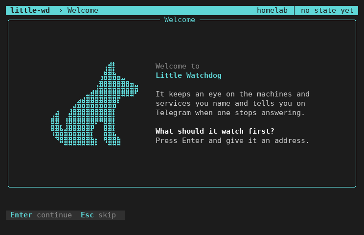
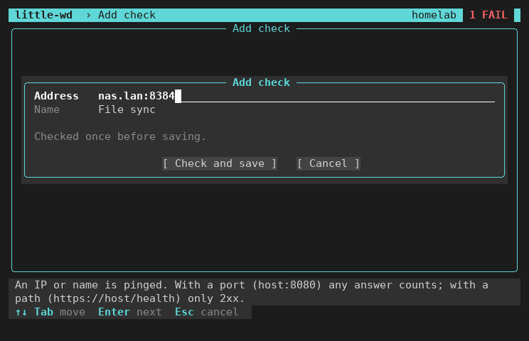

# Setup guide

Four steps to the first alarm on your phone: install, first check, Telegram,
dead-man's switch.

## 1. Install

Download only from the
[releases](https://github.com/DockSeed/little-watchdog/releases). The command
picks the right file for your device (`amd64`, `arm64` or `armhf`):

```sh
v=0.6.0
base=https://github.com/DockSeed/little-watchdog
deb=little-watchdog_${v}_$(dpkg --print-architecture).deb
wget -q --show-progress $base/releases/download/v$v/$deb $base/releases/download/v$v/SHA256SUMS \
  $base/releases/download/v$v/SHA256SUMS.sig $base/raw/v$v/allowed_signers
```

**Verify the download.** The first command prints the fingerprint of the
signing key. It must be `SHA256:CMUY2ymSviJh+qEqswCASwZfhcosZc9kMfzcWAjuHEs`,
as on the release page. The second must print `OK`, the third `Good`.

```sh
grep -v '^#' allowed_signers | cut -d' ' -f3- | ssh-keygen -lf -
sha256sum -c --ignore-missing SHA256SUMS
ssh-keygen -Y verify -f allowed_signers -I release@little-watchdog -n file -s SHA256SUMS.sig < SHA256SUMS
```

This catches a changed download, not a takeover of the whole GitHub account.

**Install the package:**

```sh
sudo apt install ./$deb
```

The installer asks to add you to the group `little-wd`, which may read the
Telegram token and change the checks. Type `y`. Any other answer adds nobody
and prints the `usermod` command for later.

Then log out and in again. Close an SSH session completely; a new shell is not
enough. With SSH connection sharing also run `ssh -O exit HOST`. `id` now lists
`little-wd`.

Other distributions: unpack the `.tar.gz` and run `sudo ./install.sh`
(`./install.sh --dry-run` shows first what it would do).

## 2. First check

Run `little-wd`. On the first start it greets you:



Press Enter and type an address. The name below it is optional: any text,
shown in the list and in Telegram.



little-wd works out what to watch from the address:

| You type | Watched as | OK when |
|---|---|---|
| `192.168.1.10` or `nas.lan` | ping | it answers ping |
| `192.168.1.10:2283` or `https://example.org` | web, lenient | any answer below 500, after redirects; a port that answers but is no website counts too (shown in yellow) |
| `https://example.org/health` (with a path) | web, strict | 200 to 299, after redirects |

Enter saves the address, checks it once and shows the result. An address that
fails is saved too; the result says why. The form then waits for the next
address. Esc leaves, also during the check; saved checks stay.

Some machines (Windows) do not answer ping. Give a port then, for example
`192.168.1.20:3389`.

Esc on the welcome screen skips the first check. Later, add checks with **Add
check** in the menu. The screens in detail: [screens.md](screens.md).

## 3. Telegram

On the first start, little-wd asks for a bot token as soon as you leave the
form with Esc.

1. You need a Telegram account (free, needs a phone number) and the app on
   your phone ([telegram.org/apps](https://telegram.org/apps)). For the next
   steps, [Telegram Web](https://web.telegram.org/a/) next to the terminal is
   easiest.
2. Open a chat with **@BotFather**, send `/newbot`, choose a name. You get a
   **token**. Keep it secret: whoever has it can send as your bot.
3. Open a chat with your new bot and press **Start**.
4. Paste the token into `little-wd` (later: menu, **Telegram**). It stays
   hidden; Ctrl-R shows it. Send the `/start CODE` that `little-wd` shows to
   your bot. A test message confirms the link.

Done. From now on:

- A check runs once a minute.
- After 3 failed rounds in a row you get an alarm.
- After 2 good rounds in a row you get the all-clear.
- `/status` in the chat lists all checks.
- Messages that cannot be sent wait and go out later.

Change the timing under **Settings** in `little-wd`.

For a group: add the bot to the group and send `/start@your_bot CODE` there.
Use a separate bot for the watchdog. If the token leaks, revoke it with
@BotFather and paste the new one.

## 4. Dead-man's switch (recommended)

Telegram cannot tell you that the watchdog itself died. A dead-man's switch
can: the watchdog pings a URL, by default every 2 minutes. When the pings stop,
[Healthchecks.io](https://healthchecks.io) alarms you. It has a free plan and
can be self-hosted.

1. Create an account and a check there.
2. Set **Period** to the same time as **Every** in `little-wd` (at least
   60s), and **Grace Time** to at least twice that (4 minutes for 2m).
3. Copy the ping URL (keep it secret). Paste it in `little-wd` under
   **Dead-man's switch**. Later, an empty URL keeps the current one and `off`
   switches it off.
4. In Healthchecks, set up a notification other than Telegram, for example
   email.

After 3 failed Telegram sends in a row, the watchdog pings the URL with `/fail`,
so Healthchecks alarms you.

## Several machines

Give each machine its own bot:

1. Ask @BotFather for one more bot per machine.
2. Add all of them to one group.
3. Pair each machine with that group (step 3).

Every message starts with the machine name, so you see where it comes from. In
the group, `/status@name_of_the_bot` asks one machine; a plain `/status` is
answered by every machine in the group.

Two machines must not share one bot. Telegram hands a bot's messages to one
reader only, so `/status` would stop working, and `little-wd` then shows
"another program uses this bot".

## Update and remove

| | |
|---|---|
| Update | Install the newer `.deb` as in step 1. |
| Remove | `sudo apt remove little-watchdog` (`purge` also deletes the config with the bot token). |
| tar.gz | `sudo ./install.sh --uninstall [--purge]` |

## If nothing arrives

- `journalctl -u little-watchdog -e` shows the service log.
- The menu says when the service is not running or your login lacks the group.
- `little-wd check` runs all checks once and prints the results, without
  sending anything.

Sources: [core.telegram.org/bots/tutorial](https://core.telegram.org/bots/tutorial),
[healthchecks.io/docs](https://healthchecks.io/docs/)
